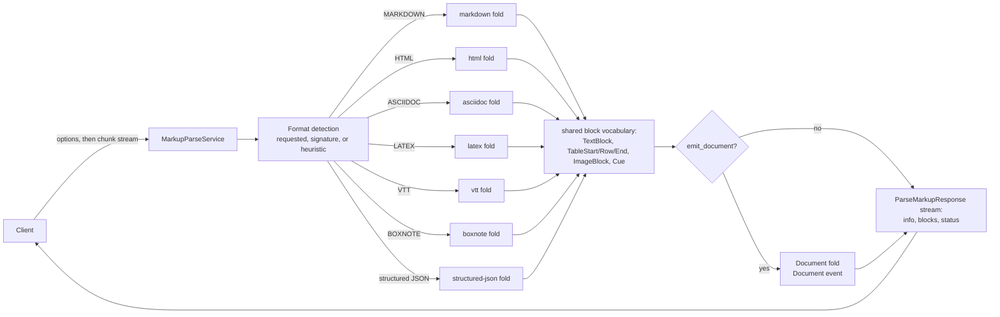

# grpc-markup

gRPC collector for lightweight text markup — Markdown, HTML, AsciiDoc,
LaTeX, WebVTT, BoxNote and serialized Docling JSON — projecting into the
gRParse Document data plane.

One Rust process maps every format onto one shared block vocabulary: a
heading is the same `TextBlock` whether it was `# Title` or a BoxNote
heading node, a table streams as `TableStart` / `TableRow` / `TableEnd`
whichever source wrote it, and an optional fold turns the whole parse into
one `ai.pipestream.document.v1.Document` a coordinator can merge with
another collector's parse of the same work. All seven formats in the
contract are mapped; asking for a format outside the registry (there is
none today) is `UNIMPLEMENTED` with the format named. It is not PipeStream
core.



## Build and run

```bash
cargo build --release          # build.rs compiles proto/ with tonic-prost-build
cargo test                     # unit + integration; no network, no fixtures on disk
cargo clippy --all-targets
cargo fmt --check
buf lint

./target/release/grpc-markup   # listens on 0.0.0.0:50065
```

Container, with the tests gating the image and a read-only root filesystem:

```bash
docker build -t grpc-markup .
docker run --rm --read-only -p 50065:50065 grpc-markup
```

Poke at it with reflection, no local protos required:

```bash
grpcurl -plaintext localhost:50065 list
grpcurl -plaintext localhost:50065 ai.pipestream.markup.v1.MarkupParseService/GetServiceInfo
grpcurl -plaintext localhost:50065 grpc.health.v1.Health/Check
```

`protoc` is required to build (the build script invokes it through
tonic-prost-build). `buf` is only needed to lint the contract.

## Wire API

Package `ai.pipestream.markup.v1`, service `MarkupParseService`, contract in
[`proto/ai/pipestream/markup/v1`](proto/ai/pipestream/markup/v1). Every
message, field, enum value and RPC carries a documentation comment; `buf
lint` runs `STANDARD` + `COMMENTS` with comment ignores disallowed.

```text
rpc ParseMarkup(stream ParseMarkupRequest) returns (stream ParseMarkupResponse);
rpc GetServiceInfo(GetServiceInfoRequest) returns (GetServiceInfoResponse);
```

`GetServiceInfo` also carries a `ui` block (`title`, `path`, `description`)
advertising this service's tab in the shared demo shell.

**Request.** The first frame sets `options`; every frame after it carries a
`chunk` of document bytes, concatenated in stream order. `options` twice, or
a frame with neither field, is `INVALID_ARGUMENT`.

| Option | Meaning |
|---|---|
| `format` | `MARKDOWN` / `HTML` / `ASCIIDOC` / `LATEX` / `VTT` / `BOXNOTE` / `DOCLING_JSON`, or unset to sniff. `RST` is named by the contract and mapped by no build, so asking for it is `UNIMPLEMENTED` |
| `max_document_mib` | Per-request byte cap; 0 takes the server default, over the ceiling clamps |
| `emit_document` | Also fold the parse into one `ai.pipestream.document.v1.Document`, sent just before the trailer (see below) |
| `emit_inline_spans` | Carry the formatting, link and reference runs inside each block. Unset means on; clear it for a flat stream |

**Response.** Exactly one `info` first, content events in document order,
exactly one `status` last. Stream indexes are dense across every indexed
event kind.

| Event | Carries |
|---|---|
| `info` | `MarkupInfo`: resolved format and the evidence for it, declared title, document metadata as a typed `MetaValue` tree holding the shape the source declared (front matter as its own tree, header lines as scalars) |
| `text_block` | One unit of text: title, section header, paragraph, list item, code, formula, caption, quote, footnote. `role` is an open refinement (`html`, `admonition`, a footnote label); `spans` are the runs inside the text, `anchor_id` the anchor the block declares, `admonition` the callout kind, `task_state` a list item's checkbox, `quote_depth` how deep a quotation sat, `raw` the markup behind a flattened HTML block |
| `table_start` / `table_row` / `table_end` | A table, streamed a row at a time, header rows and cells flagged, column and row spans carried, the source's declared column geometry on `table_start`, and each cell's own alignment and inline runs |
| `image` | One image reference — `src`, `alt`, `title` as written, the `width`/`height` the document asks for verbatim in the author's own units, and the `anchor_id` the source names on the image itself. Never dereferenced, so never measured |
| `cue` | One WebVTT cue: identifier, timings in milliseconds, speaker, flattened text, the `spans` its styling, class and language tags left, and the `timings` its karaoke timestamps cut it into |
| `document` | The whole parse folded into one `Document`. Only when `emit_document` was set, exactly once, immediately before `status` |
| `status` | `ParseStatus`: format, counts, aggregated warnings, bytes consumed, elapsed |

Every item carries a `CollectorSource` (`collector = "markup"`, `model` =
the fold: `markdown`, `vtt`, `boxnote`, `docling-json`) and, where the
format is line-oriented, a 1-based `source_line`.

**Errors.** A failed parse ends the stream with a status and no `status`
event:

| Condition | Code |
|---|---|
| Over the byte cap (refused on the crossing chunk, mid-upload), or past the concurrency limit | `RESOURCE_EXHAUSTED` |
| Input the format's own error rules cannot repair: a VTT without its header, bytes that are not the JSON a JSON format requires, a legacy `atext` BoxNote | `INVALID_ARGUMENT` |
| A format outside the build (none today; the registry, not the enum, decides), or a sniff that found nothing | `UNIMPLEMENTED` |
| A parser fault | `INTERNAL` |

Warnings never fail a parse. They aggregate per (code, message) on the
trailer, so a document with ten thousand instances of one finding produces
one warning with a count.

## Web demo

[`demos/node-client`](demos/node-client) is a dependency-light node:http
bridge (only `@grpc/grpc-js` and `@grpc/proto-loader`) plus a live viewer
page: pick a format or let the server sniff it, upload or paste markup, and
watch the shared block vocabulary stream back over Server-Sent Events on the
same response that carries the upload up.

```bash
cd demos/node-client
npm install
npm start                              # http://127.0.0.1:8088
UI_BASE=/ui/markup npm start           # mounted the way the demo shell does
```

The bridge honours `MARKUP_ADDR` (default `127.0.0.1:50065`), `PORT` (default
`8088`) and `UI_BASE`. Samples for every mapped format live in
[`demos/sample-data`](demos/sample-data); they mirror the golden fixtures the
test suite pins as string literals.

## Format coverage

| Format | Sniffed by | Mapped |
|---|---|---|
| Markdown | Heuristic only (ATX headings, fences, links, a front-matter fence) | headings (first H1 = title) with `{#id}` anchors, paragraphs, nested lists with markers as written, task lists, definition lists, fenced/indented code with language, blockquotes, GFM alerts as admonitions, pipe tables with their column alignments, images, footnote bodies as anchors and references as runs, display math, sub/superscript, emphasis and links as runs, YAML or TOML front matter to metadata; raw HTML flattened to text with a warning |
| WebVTT | `WEBVTT` signature | header title and `Key: value` metadata, cues with millisecond timings, voice spans to `speaker`, `<b>`/`<i>`/`<u>` and class and `<lang>` tags as runs over the cue text, karaoke timestamps as timed segments, NOTE/STYLE/REGION skipped, malformed cues skipped with a warning |
| BoxNote | JSON with a ProseMirror `doc` tree (or legacy `atext`, refused) | headings, paragraphs with every mark as a run (bold, italic, underline, strikethrough, code, highlight, colour, family, size), nested/check lists, code, quotes, spanned tables, images, safe-scheme links |
| Docling JSON | JSON whose `schema_name` names a DoclingDocument | field-by-field re-ingestion of the core arrays; typed events are a projection of the body in reading order; unconsumed keys warn per key path |
| HTML | `<!DOCTYPE html` or `<html` signature | whole documents and body-only fragments (html5ever); head title and `meta.*` metadata keyed by `name` or `property`, h1-h6 ladder (first h1 = title), paragraphs, blockquotes, ul/ol/dl nesting, spanned tables with captions and `colgroup` geometry and per-cell alignment, `pre` code with `language-*` classes, figures and images, the inline element set as runs, every `href` as a link run with `#fragment` links typed as cross references, `id` as an anchor; script/style/head never become text; tree-builder repairs warn as malformed structure |
| AsciiDoc | Heuristic only (`= ` title, `== ` sections, `:name: value` entries, `----` fences) | attribute entries to metadata, `= `/`== ` title and section ladder (level is marker length minus one), multiline paragraphs, admonitions as `role: "admonition"` plus the kind, `*`/`.` lists nested by marker depth with markers as written, `|===` tables with the first row as header and cell specifiers honoured (span and duplication factors, alignments, header and emphasis style letters), `[source,lang]` + `----` listings as code, `image::` macros with `.Caption` lines, `[[id]]` anchors on their own line or inline |
| LaTeX | `\documentclass` or `\begin{document}` | preamble skipped with `\title`/`\author`/`\date` surfaced, section ladder (part/chapter/section 1 through subparagraph 5), text wrappers as style runs, `\cite`/`\ref`/`\eqref` as typed references and `\label` as the anchor they resolve to, `\href`/`\url` as link runs, `\footnote` as a marker run plus an anchored body, itemize/enumerate/description nesting, tabular with its column preamble as geometry and `\multicolumn`/`\multirow` spans, verbatim/lstlisting/tikz as code, equation family and `$$`/`\[..\]` as formulas, `\includegraphics` by reference, quotes, theorems, bibliographies anchored by `\bibitem` key; unknown environments descend with one aggregated warning |

Sniffing order is the one [`docs/design.md`](docs/design.md) fixes: an
explicit request wins outright, then unambiguous signatures, and only then a
Markdown / AsciiDoc / reStructuredText structure heuristic. The server never
guesses between candidates it cannot separate — bytes that match more than
one fail closed. reStructuredText is recognized so a `.rst` file is refused
by name rather than mapped as Markdown; no build maps it.

### Inline runs

Every block and every table cell carries `spans`: one `InlineSpan` per run
of its flattened text that says something the flat string cannot — bold,
italic, code, sub/superscript and the rest as `SpanStyle`s, a link with its
title, an anchor the run declares, a key it points at with the kind of
reference it is, the source notation flattening removed, and a run's own
colour, family and size where the source states them.

Ranges are half-open and count **code points**, not bytes, into the same
event's `text`, so a consumer indexes the string it was handed. Runs come
back in start order and may nest. `TextBlock.hyperlink` still means "this
whole block is one link"; every other URL is a span, which is why a
paragraph with three links now yields three URLs instead of none.

## The Document projection (opt-in)

Set `emit_document` and the server folds its own event stream into one
`ai.pipestream.document.v1.Document` and sends it as a `document` event
immediately before the trailer. The typed events still go out first,
unchanged and in order. With the option off, the fold is never constructed.

The fold is [`src/document_fold.rs`](src/document_fold.rs) — a standalone,
directly-testable module. The schema is vendored byte-identical from the
gRParse repository into
[`proto/ai/pipestream/document/v1`](proto/ai/pipestream/document/v1) and is
never edited here.

| Wire event | Document |
|---|---|
| `info` | `name` (the declared title), `origin.mimetype` per format, `source_meta` (title, authors, dates, language, generator, keywords in their own slots, other scalars in `extra`), HTML `meta.*` pairs as typed `meta_tags`, and the whole metadata tree on the body meta under the fold's prefix (`markdown.author`, …) — scalar to string, list to `ListValue`, map to `Struct` |
| `text_block` | A `BaseTextItem` variant chosen by label — `TitleItem`, `SectionHeaderItem`, `ListItem`, `CodeItem`, `FormulaItem`, else `TextItem`. Quotes fold as `TEXT` with the quotation recorded in custom fields; a declared code language maps onto `CodeLanguageLabel` when it matches an enum name, else `code_language_raw` |
| `text_block` list items | Grouped under `GROUP_LABEL_LIST` / `GROUP_LABEL_ORDERED_LIST` groups, one per contiguous list, nested lists as nested groups |
| `text_block` spans | `TextItemBase.spans`, styles folded onto the schema's own `Formatting` and `Script`, link titles and raw payloads alongside; an `admonition` becomes `admonition_kind` |
| `text_block` anchors and references | Every `anchor_id` becomes a `NamedAnchor` in `anchors`; every span keeps its `reference` key verbatim and gains a `FineRef` into the item declaring that anchor, resolved at the end of the parse. A table cell's runs go through the same pass, patching both `grid` and `table_cells`; an anchor a cell declares points at the table. A reference nothing declares keeps the key and no target. `ReferenceKind` is refined by what the key resolved to: a formula is an equation reference, a picture a figure one, a table a table one |
| headings | `Document.outline`, one entry per title and section header, each pointing at its item |
| `table_*` | One `TableItem`: both `grid` and flat `table_cells`, offsets honoring spans, each cell's own inline runs and declared alignment, the source's column geometry as nameless `TableColumnSchema` entries (a bare width is a page unit, `20%` and `5cm` keep their spelling), a leading caption created as a `CAPTION` item and referenced |
| `image` | A `PictureItem` whose `ImageRef.uri` is the `src` verbatim — no bytes and no dpi. `ImageRef.size` when the source declared both dimensions as bare numbers, `ImageRef.size_raw` (`width=50%,height=5cm`) for every other spelling |
| `cue` | A `TextItem` whose provenance is a `TrackSource` (timings in seconds, identifier, voice) alongside the collector stamp, its runs on `spans`, and one `ProvenanceItem` per karaoke segment carrying a `TimeSpan` and the `charspan` it covers |
| `source_line` (any event) | A `ProvenanceItem` carrying a `LineSpan`, half-open and 1-based; no page and no box ride with it |
| `status` | Nothing; it describes the stream, not the document |

For `DOCLING_JSON` the `document` event is not a re-fold: the ingested
document is carried over item for item, with this collector's
`CollectorSource` appended to each item's sources (attribution is additive;
sources never overwrite each other).

Structure is a heading-as-parent ladder: a section header of level N is parented
to the nearest open header of a lower level (`#/body` when there is none)
and the content after it hangs off that header. Refs are dense and local
(`#/texts/0`, `#/tables/1`) with `parent` and `children` reciprocal, which
is what lets the coordinator merge the fragment additively;
`document_fold::integrity_errors` is that contract as a check, and every
fold test asserts it is empty. Markup has no pages and no boxes, so no item
carries a `prov` box — except cues, whose track timing is real provenance
and whose karaoke segments are real timed ranges, and ingested Docling JSON
payloads, whose provenance passes through untouched.

## Security and bounds

- **Diskless.** Document bytes are buffered in memory — these parsers need
  the whole text, unlike a pull parser — and nothing is ever written. The
  image runs `--read-only` with no tmpfs.
- **Nothing is fetched.** Image references, links and URIs stay the strings
  the source wrote. Embedded HTML inside Markdown is still flattened to its
  text; standalone HTML parses without fetching a single subresource.
- **Bounded.** The byte cap is enforced on the chunk that crosses it, while
  the client is still uploading; concurrent parses are capped and refused
  rather than queued; the response channel is small, so a client that stops
  reading stops the parse.
- **Bounded trailer.** Warnings aggregate per (code, message) and the table
  of distinct kinds is capped, so a hostile document cannot grow the trailer
  without bound.

## Environment

| Variable | Default | Meaning |
|---|---|---|
| `GRPC_MARKUP_ADDR` | `0.0.0.0:50065` | Listen address |
| `GRPC_MARKUP_WORKERS` | CPU count | Tokio worker threads |
| `GRPC_MARKUP_BLOCKING_THREADS` | 512 | Blocking pool that runs the parsers |
| `GRPC_MARKUP_MAX_CONCURRENT_PARSES` | 64 | Parses admitted at once; past it, `RESOURCE_EXHAUSTED` |
| `GRPC_MARKUP_MAX_DOCUMENT_MIB` | 256 | Byte cap when a request asks for 0 |
| `GRPC_MARKUP_MAX_DOCUMENT_MIB_CEILING` | 1024 | Hard cap a request cannot exceed |
| `GRPC_MARKUP_METRICS_INTERVAL_SECS` | 60 | Seconds between metrics lines; 0 disables |
| `GRPC_MARKUP_WINDOW_BYTES` | 16 MiB | HTTP/2 initial stream and connection window |

Metrics are a line on stdout on that interval — parses started, ok, failed,
refused, capped, bytes in, events out, and a per-format count. The counters
live in [`src/metrics.rs`](src/metrics.rs) if a Prometheus endpoint is ever
wanted.

## Layout

```text
proto/ai/pipestream/markup/v1/    the contract; buf lint STANDARD + COMMENTS
proto/ai/pipestream/document/v1/  the Document plane, vendored from gRParse
src/sniff.rs                      format resolution and its evidence
src/parse.rs                      the shared driver: emitter, envelope, fold registry
src/markdown.rs                   the Markdown fold (pulldown-cmark)
src/html.rs                       the HTML fold (html5ever via scraper)
src/asciidoc.rs                   the AsciiDoc fold (line-oriented)
src/latex.rs                      the LaTeX fold (hand-rolled tolerant reader)
src/vtt.rs                        the WebVTT fold (hand-written cue parser)
src/boxnote.rs                    the BoxNote fold (doc-tree walk)
src/docling_json.rs               the Docling JSON fold (field-by-field ingestion)
src/document_fold.rs              the opt-in fold from events to one Document
src/service.rs                    tonic wiring, framing, byte cap, admission control
src/metrics.rs                    counters and the interval line
demos/node-client/                the web viewer: node:http SSE bridge plus page
demos/sample-data/                one sample per format, mirroring the test literals
tests/markdown.rs                 golden mappings for the Markdown fold
tests/html.rs                     golden mappings for the HTML fold
tests/asciidoc.rs                 golden mappings for the AsciiDoc fold
tests/latex.rs                    golden mappings for the LaTeX fold
tests/vtt.rs                      golden mappings for the WebVTT fold
tests/json_formats.rs             golden mappings for BoxNote and Docling JSON
tests/document.rs                 the Document fold per format, placement, integrity
tests/server.rs                   framing, caps, admission, sniffing, refusals, info
```

Adding a format is one fold module plus one entry in `parse::REGISTRY`;
`GetServiceInfo.formats`, the dispatch and the `UNIMPLEMENTED` refusals all
follow from the registry.

## Docs

- [AGENTS.md](AGENTS.md) — read order, definition of done, git
- [Design](docs/design.md) — format mappings, what the projection drops, sniff precedence
